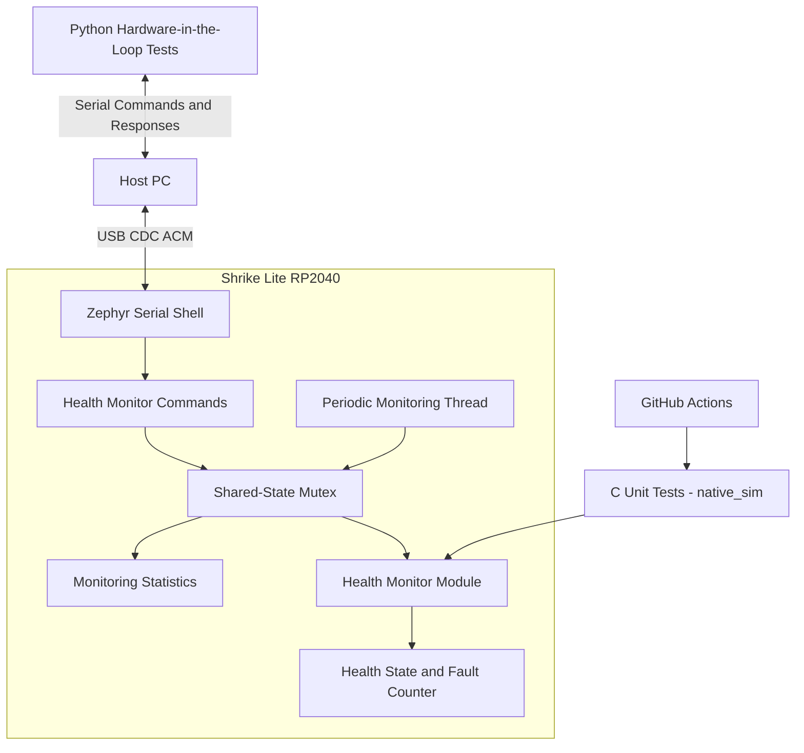

# Embedded Device Health Monitor

A Zephyr RTOS-based embedded firmware project for monitoring device health, tracking simulated faults, and exposing runtime diagnostics through a USB serial shell. The project combines C firmware, concurrent task execution, automated unit testing, hardware-in-the-loop validation, and continuous integration.

**Target hardware:** Shrike Lite RP2040  
**RTOS:** Zephyr  
**Language:** C  
**Host-side testing:** Python, PySerial  
**Unit testing:** Zephyr ztest with `native_sim`  
**CI:** GitHub Actions

[Source Code](https://github.com/SarangKudtarkar/embedded-device-health-monitor) · [GitHub Actions](https://github.com/SarangKudtarkar/embedded-device-health-monitor/actions)

---

## 1. Project Overview

Embedded devices often need a way to expose their runtime state, track fault conditions, and provide useful diagnostic information during development and debugging.

This project implements a lightweight device health monitor on the Shrike Lite RP2040 using Zephyr RTOS. It separates health-state management from the application layer and provides a serial command interface for inspecting the system and injecting simulated faults.

The firmware runs a periodic monitoring thread while accepting commands through a Zephyr shell over USB CDC ACM. A mutex protects shared monitoring state accessed by multiple execution contexts.

The project also includes a host-side Python test suite for the physical board, C unit tests for the health-monitor module, and a GitHub Actions workflow for automated unit-test execution.

### Key engineering objectives

- Develop and build firmware using Zephyr RTOS.
- Separate application logic from health-state management.
- Implement periodic monitoring with a dedicated RTOS thread.
- Protect shared state against concurrent access.
- Expose runtime diagnostics through a serial shell.
- Validate fault handling and counter behavior using automated tests.
- Integrate repeatable testing into a Git-based development workflow.

## 2. System Architecture



### Component responsibilities

| Component | Responsibility |
|---|---|
| Application layer | Initializes the health monitor and starts the monitoring thread |
| Monitoring thread | Periodically increments the monitoring report counter |
| Health-monitor module | Initializes, records, clears, and queries fault state |
| Zephyr shell | Exposes runtime commands over USB serial |
| Mutex | Protects shared monitoring data accessed by the thread and shell handlers |
| C unit tests | Validate health-state transitions and counter behavior |
| Python test suite | Exercises the running firmware through the serial interface |
| GitHub Actions | Builds and executes the C unit tests automatically |

## 3. Firmware Design

### Health-monitor module

The health-monitor functionality is implemented in a separate C module, making its core logic testable independently of the hardware-facing application.

The public interface is defined in `include/health_monitor.h`, with the implementation in `src/health_monitor.c`.

The module maintains a fault counter and provides functions to:

- Initialize the monitor in a healthy state.
- Record a fault.
- Clear recorded faults.
- Query whether the monitor is healthy.
- Read the current fault count.

The health state is derived from the fault counter: zero recorded faults represents a healthy state; a nonzero count represents a fault state.

### Fault-counter overflow handling

The fault counter uses an unsigned 32-bit integer. The implementation checks against `UINT32_MAX` before incrementing, preventing the counter from wrapping around to zero and incorrectly indicating a healthy state.

A unit test verifies that the counter saturates at its maximum value.

### Periodic monitoring thread

The application creates a dedicated Zephyr thread for periodic monitoring.

Current implementation settings:

- Reporting interval: 500 ms
- Thread priority: 5
- Stack allocation: 1024 bytes

The monitoring thread periodically updates the report counter. This provides a simple runtime indicator that the monitoring task continues to execute.

These settings are implementation choices for this project, not universal recommendations for every embedded system.

### Concurrency and shared-state protection

The monitoring thread and serial shell handlers access shared monitoring data. A Zephyr mutex protects these accesses.

The implementation follows a short critical-section pattern:

1. Acquire the mutex.
2. Read or update the shared state.
3. Copy values locally when appropriate.
4. Release the mutex.
5. Print diagnostic output after releasing the mutex where applicable.

This keeps shared-state access synchronized without holding the mutex unnecessarily during serial output.

## 4. Serial Diagnostic Interface

The firmware exposes a Zephyr shell over USB CDC ACM. Connect the board to the host PC and open the serial port using a terminal application.

**Default terminal settings**

- Baud rate: 115200
- Data bits: 8
- Parity: None
- Stop bits: 1
- Flow control: None

The default Windows COM port used during testing was `COM4`. The assigned port may differ between systems.

### Available commands

| Command | Description |
|---|---|
| `status` | Reports health state and uptime |
| `stats` | Reports monitoring and fault counters |
| `fault` | Injects a simulated fault |
| `fault_clear` | Clears the fault state and resets the fault counter |

### Example diagnostic workflow

1. Run `status` to inspect the initial health state.
2. Run `stats` to inspect monitoring statistics.
3. Run `fault` to inject a simulated fault.
4. Run `status` again and verify the fault state is reported.
5. Run `fault_clear` to restore the healthy state.
6. Run `stats` to verify that the fault counter is reset.

The `fault` command is intended for development and validation. It does not represent detection of a real hardware failure.

## 5. Repository Structure

```text
embedded-health-monitor/
├── .github/
│   └── workflows/
│       └── unit-tests.yml
├── boards/
│   └── shrike_lite.overlay
├── include/
│   └── health_monitor.h
├── src/
│   ├── main.c
│   └── health_monitor.c
├── tests/
│   ├── unit/
│   │   ├── CMakeLists.txt
│   │   ├── prj.conf
│   │   └── src/
│   │       └── main.c
│   ├── run_unit_tests.sh
│   └── test_health_monitor.py
├── CMakeLists.txt
├── prj.conf
├── README.md
└── .gitignore
```

Generated build directories are excluded from version control.

## 6. Development Environment

The firmware was developed using a Linux environment under WSL on Windows.

| Tool | Purpose |
|---|---|
| Zephyr RTOS | Firmware framework and kernel |
| West | Workspace management and build orchestration |
| CMake and Ninja | Build configuration and execution |
| Zephyr SDK | Firmware compilation toolchain |
| Python and PySerial | Host-side serial test automation |
| Zephyr ztest | C unit testing |
| Git and GitHub | Version control and source hosting |
| GitHub Actions | Continuous integration |

The workspace uses Zephyr `v4.5.0-rc3`. This is a release-candidate version, so the build environment should remain aligned with the project's tested version when reproducing the results.

## 7. Build the Firmware

### Prerequisites

Set up a Zephyr workspace, install the required SDK and Python dependencies, and ensure that the `west` command is available.

Activate the project's Python environment and build the firmware:

```bash
source ~/zephyr-venv/bin/activate

cd ~/zephyrproject

west build -p always \
  -b shrike_lite \
  ~/embedded-health-monitor \
  -d ~/embedded-health-monitor/build
```

If the build succeeds, the firmware image is generated at:

```text
~/embedded-health-monitor/build/zephyr/zephyr.uf2
```

### Flash the board

The Shrike Lite board supports UF2-based flashing.

1. Copy the generated UF2 file to an accessible Windows directory.
2. Disconnect the board.
3. Hold the BOOT button while reconnecting USB, following the board's documented bootloader procedure.
4. Open the bootloader drive on Windows.
5. Copy the UF2 file to the root of that drive.
6. Wait for the board to reboot.
7. Open the serial terminal and verify that the shell responds.

For board-specific details, refer to the [Shrike Lite documentation](https://docs.zephyrproject.org/latest/boards/vicharak/shrike_lite/doc/index.html).

## 8. Testing Strategy

The project uses two complementary test layers.

### A. C unit tests

The health-monitor module is tested using Zephyr ztest on the `native_sim` target. These tests validate module behavior without requiring the physical board.

Run the existing unit-test script:

```bash
cd ~/embedded-health-monitor
./tests/run_unit_tests.sh
```

The suite covers five scenarios:

| Test | Expected behavior |
|---|---|
| Initial state | Monitor starts healthy |
| Single fault | Fault recording marks the monitor unhealthy |
| Multiple faults | Fault counter increments correctly |
| Clear faults | Fault counter resets and health is restored |
| Counter saturation | Counter remains at `UINT32_MAX` instead of wrapping |

**Previously verified result:** 5 passed, 0 failed.

### B. Python hardware-in-the-loop tests

The host-side Python script communicates with the physical board through its USB serial shell using PySerial.

The script validates the firmware's externally visible behavior rather than only testing the C module in isolation.

The seven checks cover:

1. Healthy status reporting.
2. Fault injection.
3. Fault status reporting.
4. Fault clearing.
5. Fault-counter reset.
6. Monitoring report counter increments.
7. Uptime increases over time.

The test script expects the board to be connected to `COM4` at 115200 baud by default.

On Windows, install PySerial if necessary:

```powershell
python -m pip install pyserial
```

Close PuTTY or any other serial terminal before running the tests, since the COM port generally cannot be shared by both applications.

The test script is located at `tests/test_health_monitor.py`. Copy it to an accessible Windows directory if needed, then run:

```powershell
python C:\Users\Public\test_health_monitor.py
```

**Previously verified result:** all 7 hardware checks passed.

### C. Continuous integration

The GitHub Actions workflow is located at:

```text
.github/workflows/unit-tests.yml
```

It runs on pushes, pull requests, and manual workflow dispatches. The workflow provisions the Zephyr environment, builds the unit-test application for `native_sim`, and executes the test binary.

The cloud workflow was subsequently reported to pass after the missing build dependencies were addressed.

Check the [GitHub Actions page](https://github.com/SarangKudtarkar/embedded-device-health-monitor/actions) for the current result and logs.

## 9. Design Decisions

### Why Zephyr RTOS?

Zephyr provides a real-time kernel, thread management, synchronization primitives, a shell framework, and hardware abstraction facilities. It makes this project a practical exercise in embedded firmware development beyond a single-loop application.

### Why separate the health-monitor module?

Keeping the health-state logic independent of the application improves modularity and makes it possible to test important behavior on a host simulator without requiring the board.

### Why combine unit tests and hardware-in-the-loop tests?

Unit tests validate internal module behavior quickly and repeatably. Hardware-in-the-loop tests validate the complete running firmware through the interface that a developer or diagnostic tool actually uses.

Neither layer replaces the other: passing unit tests does not by itself prove correct hardware integration.

### Why use a mutex?

The monitoring thread and shell handlers access shared counters and state. A mutex provides a clear synchronization mechanism and helps prevent inconsistent observations or updates.

## 10. Current Scope and Limitations

This project is a development-oriented health-monitoring demonstration.

- Faults are injected through a shell command; automatic detection of real hardware failures is not implemented.
- No external sensors or additional hardware are required.
- The report counter demonstrates periodic thread execution but is not a complete watchdog or scheduler-health mechanism.
- The health state is based on the fault counter and does not represent a comprehensive assessment of the device.
- The project has not been presented as a safety-certified, production-qualified, or security-hardened monitoring system.
- Automated test coverage is focused on the implemented module and serial diagnostic behavior; it is not exhaustive coverage of every possible failure mode.

These boundaries keep the project's claims aligned with its implementation and test evidence.

## 11. Potential Future Improvements

Possible extensions include:

- Add a structured fault taxonomy with fault identifiers and timestamps.
- Record fault history instead of maintaining only a counter.
- Add fault-injection tests for additional error paths.
- Test invalid shell inputs and serial communication edge cases.
- Introduce configurable reporting intervals.
- Add a heartbeat or watchdog integration with clearly defined failure semantics.
- Expand CI to include static analysis, formatting checks, and additional test configurations.
- Measure stack usage and runtime resource consumption.
- Document a reproducible debugging session using logs and debugger output.

These are future enhancements, not currently implemented features.

## 12. Engineering Skills Demonstrated

This project provides practical examples of:

- Embedded C development
- Zephyr RTOS thread creation and scheduling
- Mutex-based synchronization
- Modular firmware architecture
- Shell-based runtime diagnostics
- Fault injection and fault-state handling
- Integer overflow protection
- Host-based unit testing
- Python serial automation
- Hardware-in-the-loop validation
- CMake and West build workflows
- Git version control and continuous integration

## Author's Summary

The Embedded Device Health Monitor demonstrates how to structure a small RTOS-based firmware application, protect shared state, expose useful runtime diagnostics, and validate behavior at both module and hardware-integration levels.

The emphasis is on maintainable embedded C, reproducible testing, and observable firmware behavior. The repository serves as a foundation for further work in diagnostics, fault management, and embedded software verification.


